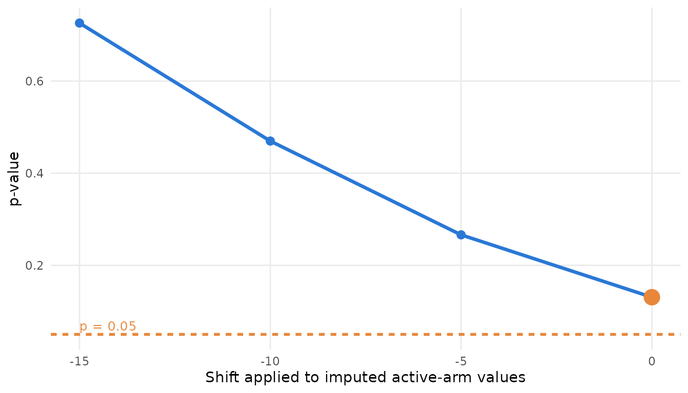

# Missing data: reference-based and delta-adjusted imputation

An MMRM assumes the missing responses are missing at random. The two
standard ways to test that assumption are reference-based imputation,
which replaces the assumption with a clinically stated one, and delta
adjustment, which asks how much worse the imputed values would have to
be before the conclusion changes.

``` r

library(ballast)
dat <- mmrm::fev_data[mmrm::fev_data$USUBJID %in% paste0("PT", 1:100), ]
spec <- stress_spec(dat, "FEV1", "USUBJID", "AVISIT", "ARMCD", "PBO", covariates = ~ FEV1_BL,
                    covariance = "us", method = "Satterthwaite", vcov = "Asymptotic")
stress_fit(spec)[, c("estimate", "stderr", "p", "n_subj")]
#>   estimate  stderr          p n_subj
#> 1 4.704172 2.15044 0.03194726     99
```

## Reference-based imputation

[`stress_reference()`](https://sullivanstatistics.github.io/ballast/reference/stress_reference.md)
fits a multivariate-normal imputation model (treatment by visit, the
subject-level covariates, unstructured covariance) and draws the missing
values under four assumptions: missing at random, jump to reference,
copy reference, and copy increments in reference. Parameter uncertainty
comes from bootstrap refits of the imputation model, one per imputation.
The vignette uses few imputations; use 25 or more in practice.

``` r

ref <- stress_reference(spec, m = 5, seed = 1)
ref[, c("label", "estimate", "stderr", "p", "note")]
#>   label estimate   stderr          p
#> 1   MAR 4.589312 2.132649 0.03504009
#> 2   J2R 3.642409 1.933720 0.06151019
#> 3    CR 3.742395 1.951151 0.05660463
#> 4   CIR 4.158507 2.121805 0.05546734
#>                                                                                                      note
#> 1 reference PBO, shift 0 on TRT, common covariance, seed 1; m = 5 of 5 converged; MC SE of estimate 0.431
#> 2 reference PBO, shift 0 on TRT, common covariance, seed 1; m = 5 of 5 converged; MC SE of estimate 0.317
#> 3 reference PBO, shift 0 on TRT, common covariance, seed 1; m = 5 of 5 converged; MC SE of estimate 0.303
#> 4 reference PBO, shift 0 on TRT, common covariance, seed 1; m = 5 of 5 converged; MC SE of estimate 0.458
```

The package’s implementation was checked against rbmi on the
antidepressant data that rbmi ships: with the same imputation model, the
same number of bootstrap draws and the same analysis model applied to
both engines’ completed data sets, all four assumptions agree within
Monte Carlo error. One caution for rbmi users: `rbmi::set_vars()` adds
only the main effects of group and visit, so the treatment-by-visit
interaction has to be named in its `covariates`.

## Delta adjustment

[`stress_tipping()`](https://sullivanstatistics.github.io/ballast/reference/stress_tipping.md)
imputes by fully conditional specification (the regression method of SAS
PROC MI), adds a shift to the active arm’s imputed values, refits and
pools. `delta = 0` is the missing-at-random multiple-imputation analysis
and is counted as an alternative; the other deltas are searches.
[`tipping_point()`](https://sullivanstatistics.github.io/ballast/reference/tipping_point.md)
interpolates the crossing and
[`plot_pcurve()`](https://sullivanstatistics.github.io/ballast/reference/plot_pcurve.md)
draws the curve.

``` r

tp <- stress_tipping(spec, deltas = c(0, -5, -10, -15), m = 5, seed = 1)
tp[, c("label", "estimate", "p", "kind")]
#>       label estimate         p        kind
#> 1   delta 0 4.309511 0.1307718 alternative
#> 2  delta -5 3.129395 0.2661672      search
#> 3 delta -10 2.029560 0.4698498      search
#> 4 delta -15 1.000075 0.7260519      search
tipping_point(tp)
#>                                                                family n
#> delta-adjusted multiple imputation delta-adjusted multiple imputation 4
#>                                    param_min param_max     p_min     p_max
#> delta-adjusted multiple imputation       -15         0 0.1307718 0.7260519
#>                                    crossing direction
#> delta-adjusted multiple imputation       NA      <NA>
plot_pcurve(tp, xlab = "Shift applied to imputed active-arm values")
```



## Intercurrent events

When an intercurrent event is the reason for the missing data,
[`stress_estimand()`](https://sullivanstatistics.github.io/ballast/reference/stress_estimand.md)
derives the analysis data sets implied by each handling strategy
(treatment policy, hypothetical, while on treatment, composite) and
refits each. A hypothetical strategy sets the post-event responses to
missing; the reference-based family can then be run on that derived data
set with `spec_update(spec, data = ...)`.
