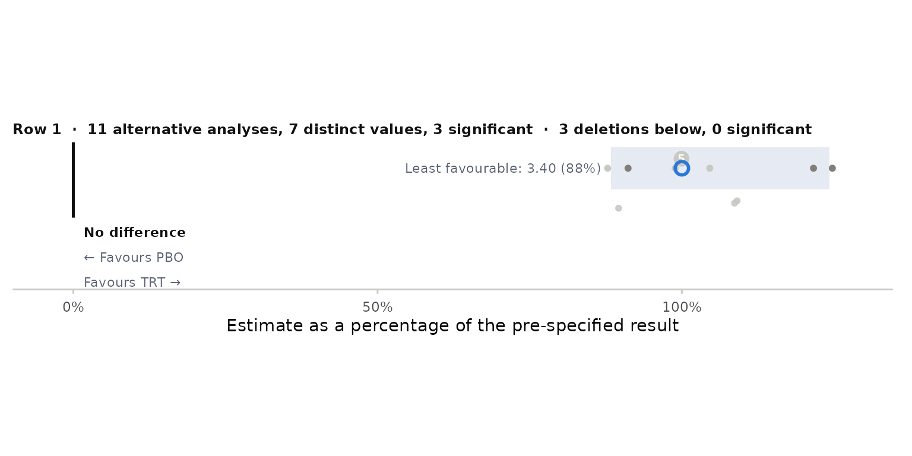

# Quickstart: stress-testing a pre-specified MMRM

A confirmatory trial has one pre-specified mixed model for repeated
measures (MMRM). ballast refits it under families of perturbations of
the modelling decisions and the data, judges every refit against the
pre-specified estimate, confidence interval and significance level, and
classifies the result as robust, sensitive or fragile.

## The pre-specified analysis

Describe the analysis once. The example uses the `fev_data` set that
ships with mmrm, restricted to 100 subjects so the vignette builds
quickly.

``` r

library(ballast)
dat <- mmrm::fev_data[mmrm::fev_data$USUBJID %in% paste0("PT", 1:100), ]
spec <- stress_spec(dat, response = "FEV1", subject = "USUBJID", visit = "AVISIT",
                    treatment = "ARMCD", reference = "PBO", covariates = ~ RACE + SEX + FEV1_BL,
                    contrast_visit = "VIS4", covariance = "us",
                    method = "Satterthwaite", vcov = "Asymptotic")
spec
#> <stress_spec> pre-specified
#>   data:       400 rows, 100 subjects, visits VIS1 VIS2 VIS3 VIS4
#>   model:      FEV1 ~ RACE + SEX + FEV1_BL + ARMCD + AVISIT + ARMCD:AVISIT + us(AVISIT | USUBJID)
#>   contrast:   TRT - PBO at VIS4
#>   inference:  Satterthwaite df, Asymptotic vcov, alpha 0.05
stress_fit(spec)
#>   family         label        kind        role is_base converged note estimate
#> 1   base pre-specified alternative sensitivity    TRUE      TRUE      3.872365
#>     stderr       df        lcl      ucl          p n_subj n_obs     aicc param
#> 1 2.069905 70.88075 -0.2550291 7.999759 0.06550197     99   279 1754.542    NA
#>   covariance        method       vcov           covariates alpha
#> 1         us Satterthwaite Asymptotic RACE + SEX + FEV1_BL  0.05
```

If you already have an `mmrm` fit,
`stress_spec_mmrm(fit, reference = "PBO")` builds the same object; from
an ADaM BDS data set,
[`stress_spec_adam()`](https://sullivanstatistics.github.io/ballast/reference/stress_spec_adam.md)
does.

## Families

Each family function returns rows in one schema. A few of them:

``` r

stress_covariance(spec, c("us", "cs", "ar1h"))[, c("label", "estimate", "stderr", "p", "is_base")]
#>   label estimate   stderr          p is_base
#> 1    us 3.872365 2.069905 0.06550197    TRUE
#> 2    cs 3.532005 1.492399 0.01867436   FALSE
#> 3  ar1h 3.398204 2.088478 0.10824537   FALSE
stress_inference(spec)[, c("label", "estimate", "stderr", "df", "p")]
#>                                label estimate   stderr        df          p
#> 1                      Satterthwaite 3.872365 2.069905  70.88075 0.06550197
#> 2                      Kenward-Roger 3.872365 2.018843  70.88075 0.05912569
#> 3             Kenward-Roger (linear) 3.872365 2.093147  70.88075 0.06847896
#> 4                           Residual 3.872365 2.069905 267.00000 0.06246752
#> 5           Sandwich, between-within 3.872365 2.000699 174.00000 0.05454936
#> 6 Jackknife sandwich, between-within 3.872365 2.070826 174.00000 0.06316891
stress_covariates(spec)[, c("label", "estimate", "p")]
#>             label estimate          p
#> 1    without RACE 4.707980 0.02963354
#> 2     without SEX 3.832708 0.07144548
#> 3 without FEV1_BL 4.046893 0.05880214
#> 4   no covariates 4.829839 0.03027465
```

Deletions, re-randomisation, reference-based and delta-adjusted multiple
imputation, other estimators, a greedy search for the smallest set of
subjects that changes the conclusion, intercurrent-event strategies and
continuous perturbation curves are the other families; see the reference
index.

## Census, verdict and figures

``` r

cen <- stress_census(spec, stress_covariance(spec, c("us", "cs", "ar1h")), stress_inference(spec),
                     stress_covariates(spec), stress_loo(spec, by = "RACE"))
summary(cen)
#> Base analysis: estimate 3.87 (SE 2.07), 95% CI -0.255 to 8, p = 0.0655
#>                family        kind  n significant crossed outside_ci reversed
#>  covariance structure alternative  2           1       1          0        0
#>             inference alternative  5           0       0          0        0
#>         covariate set alternative  4           2       2          0        0
#>   leave-one-out: RACE    deletion  3           0       0          0        0
#>       All sensitivity         all 14           3       3          0        0
#>                   All         all 14           3       3          0        0
#>  pct_min pct_max max_shift_se        role
#>       88      91         0.23 sensitivity
#>      100     100         0.00 sensitivity
#>       99     125         0.46 sensitivity
#>       90     109         0.19 sensitivity
#>       88     125         0.46 sensitivity
#>       88     125         0.46         all
stress_verdict(cen)
#> Base: estimate 3.87, 95% CI -0.255 to 8, p = 0.0655 (alpha 0.05)
#> Counted: 11 alternative analyses, 3 deletions; 3 significant, 3 crossed alpha
#> Outside base CI: 0; direction reversed: 0; largest shift: 0.463 base SE
#> Verdict: SENSITIVE over all counted rows; SENSITIVE over the 14 sensitivity analyses (same estimand; 0 supplementary rows); marginal: base p near alpha
#> Rows that crossed alpha:
#>                family         label estimate      p
#>  covariance structure            cs     3.53 0.0187
#>         covariate set  without RACE     4.71 0.0296
#>         covariate set no covariates     4.83 0.0303
plot_swarm(cen)
```



## Pre-specify and run in one call

A plan fixes the families and their settings before unblinding; printing
it gives the text a statistical analysis plan can carry.
[`standard_plan()`](https://sullivanstatistics.github.io/ballast/reference/standard_plan.md)
is the recommended set.

``` r

plan <- stress_plan(spec, covariance = list(structures = c("us", "cs", "ar1h")), inference = list(),
                    covariates = list(), weights = TRUE, loo = list(by = "RACE"), permute = list(n = 99),
                    reference = NULL, estimator = list(estimators = c("complete_cases", "ancova")),
                    fragility = list(max_k = 2))
plan
#> Pre-specified stress test
#> 
#> Pre-specified analysis: FEV1 ~ RACE + SEX + FEV1_BL + ARMCD + AVISIT + ARMCD:AVISIT + us(AVISIT | USUBJID); contrast TRT minus PBO at VIS4; Satterthwaite df, Asymptotic variance; alpha 0.05; equal LS-mean weights.
#> 
#> Perturbation families, run after unblinding exactly as listed; every refit is judged against the pre-specified estimate,
#> its 95% confidence interval and alpha. Classification: fragile if any counted alternative reverses direction or leaves the
#> pre-specified confidence interval; otherwise sensitive if any crosses alpha; otherwise robust. Specifications reached by two
#> families are counted once; tipping-point grids are searches and are not counted; deletions are counted separately.
#> 
#> 1. Within-subject covariance structure: structures = us, cs, ar1h
#> 2. Degrees-of-freedom method and variance estimator: defaults
#> 3. Covariate set: defaults
#> 4. Least-squares-mean weighting (equal versus observed margins): defaults
#> 5. Leave-one-out deletions: by = RACE
#> 6. Re-randomisation test: n = 99
#> 7. Estimator class: estimators = complete_cases, ancova
#> 8. Smallest set of subjects that changes the conclusion: max_k = 2
res <- run_plan(plan, seed = 1)
res
#> Pre-specified stress test
#> 8 families, 22 rows, 18 counted; 0.2 min
#> Base: estimate 3.87, 95% CI -0.255 to 8, p = 0.0655 (alpha 0.05)
#> Counted: 14 alternative analyses, 4 deletions; 5 significant, 5 crossed alpha
#> Outside base CI: 0; direction reversed: 0; largest shift: 1.74 base SE
#> Verdict: SENSITIVE over all counted rows; SENSITIVE over the 18 sensitivity analyses (same estimand; 0 supplementary rows); marginal: base p near alpha
#> Rows that crossed alpha:
#>                  family           label estimate      p
#>    covariance structure              cs     3.53 0.0187
#>           covariate set    without RACE     4.71 0.0296
#>           covariate set   no covariates     4.83 0.0303
#>   re-randomisation test 99 permutations     3.87 0.0300
#>  greedy deletion search             PT1     4.66 0.0179
```

[`stress_report()`](https://sullivanstatistics.github.io/ballast/reference/stress_report.md)
writes a Markdown report with the figures,
[`stress_tables()`](https://sullivanstatistics.github.io/ballast/reference/stress_tables.md)
the Word or RTF tables and the census as CSV,
[`stress_html()`](https://sullivanstatistics.github.io/ballast/reference/stress_html.md)
an interactive page, and
[`stress_log()`](https://sullivanstatistics.github.io/ballast/reference/stress_log.md)
the audit trail with the plan’s hash.
